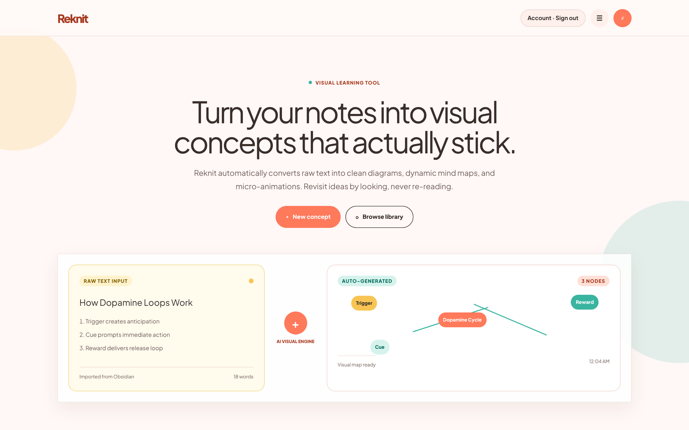
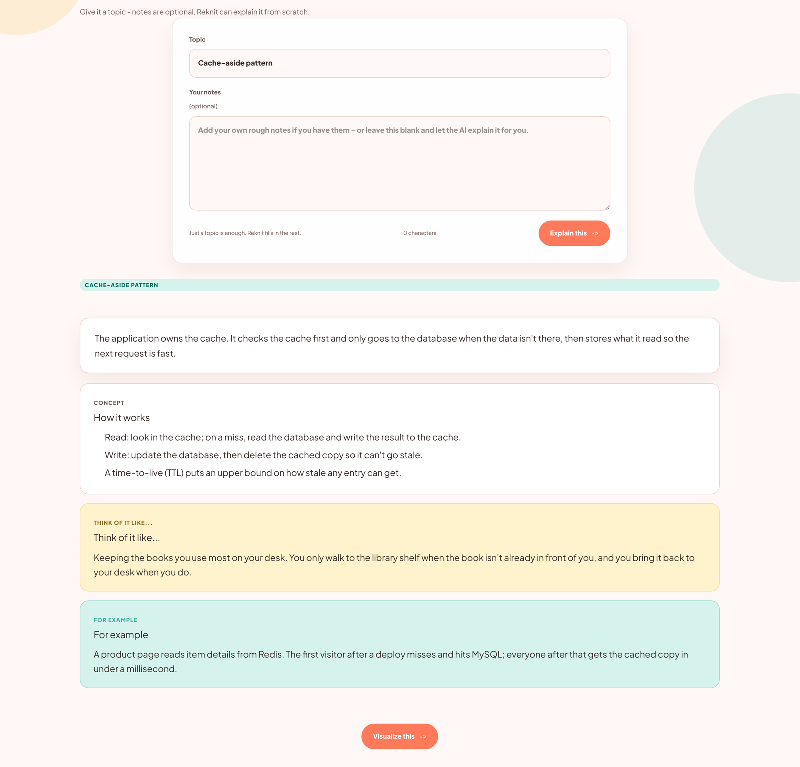
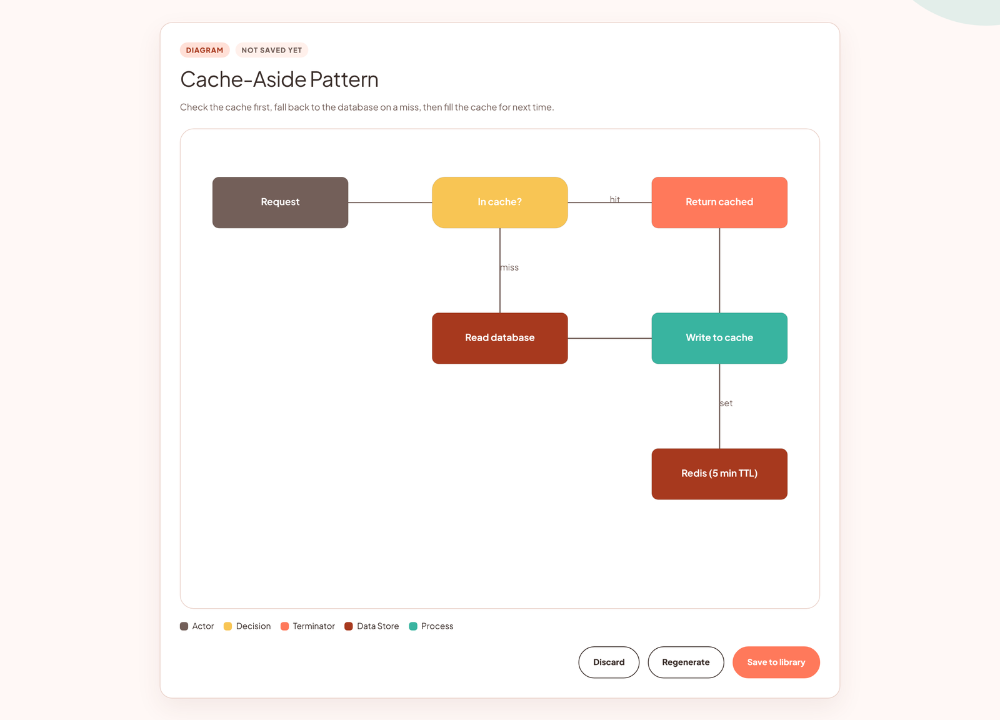
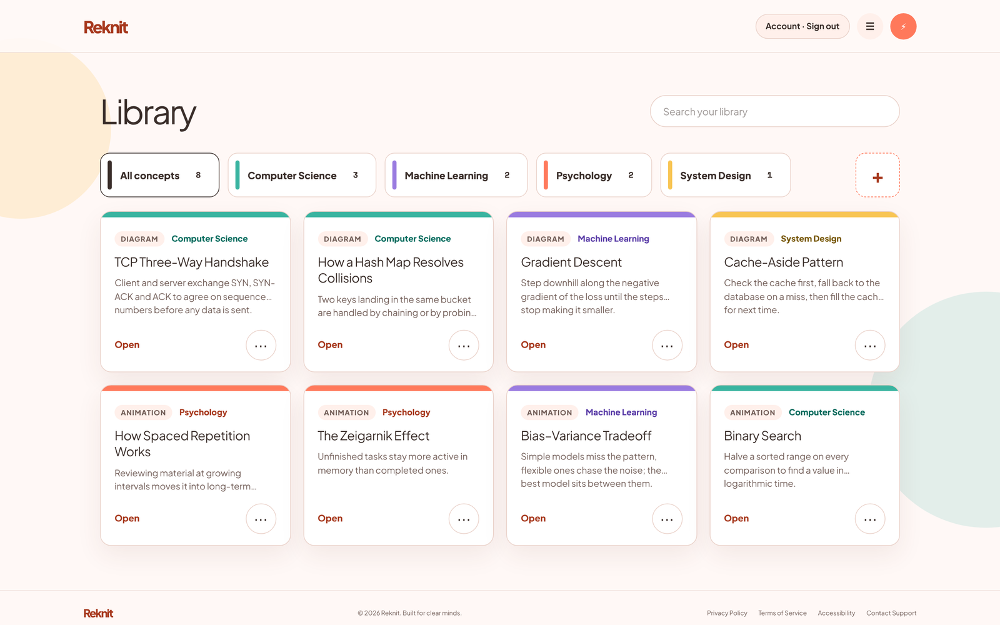
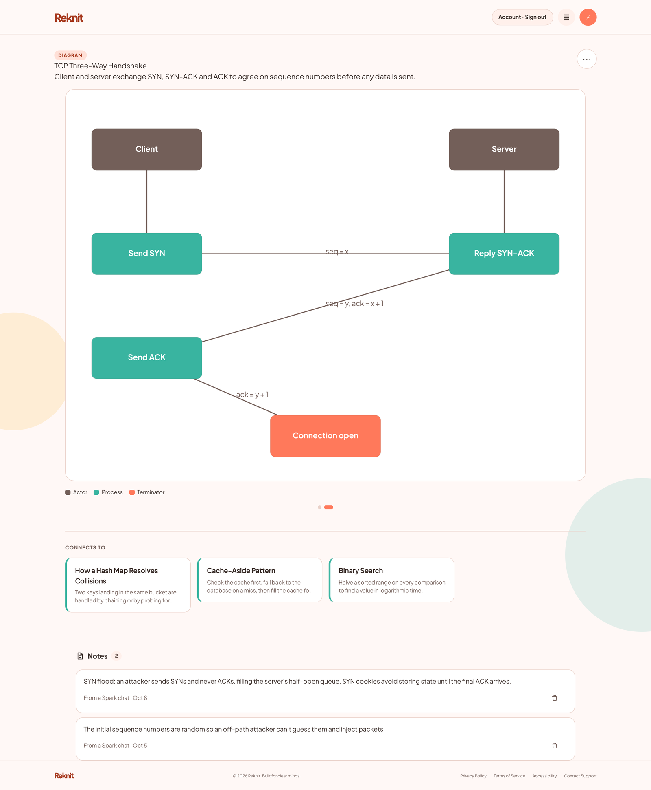
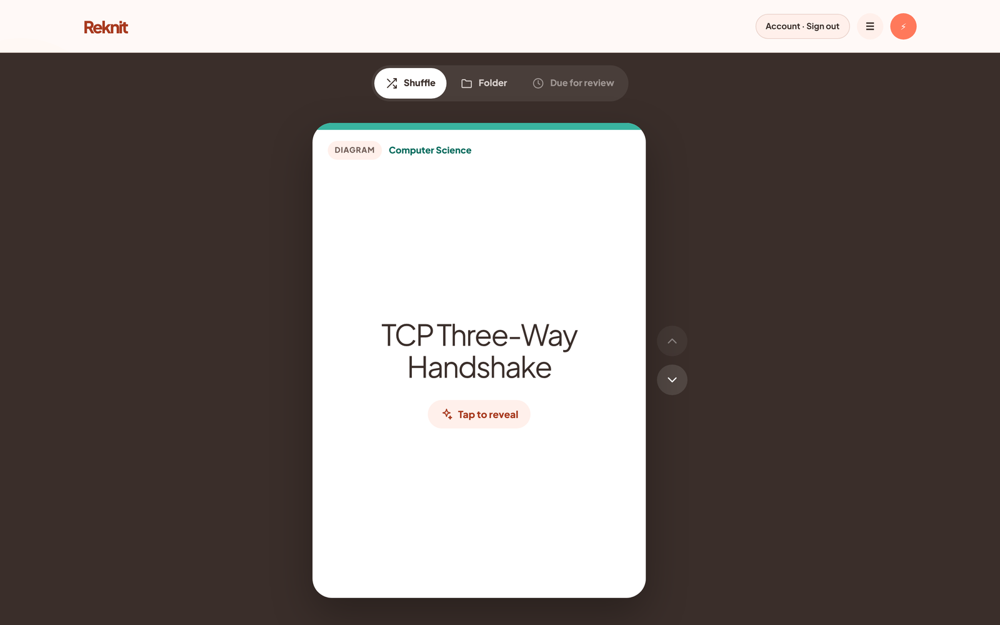
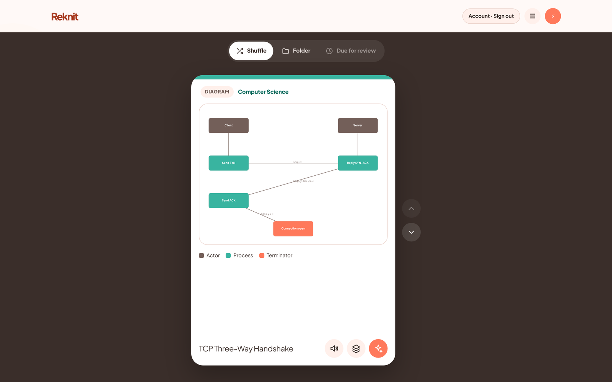
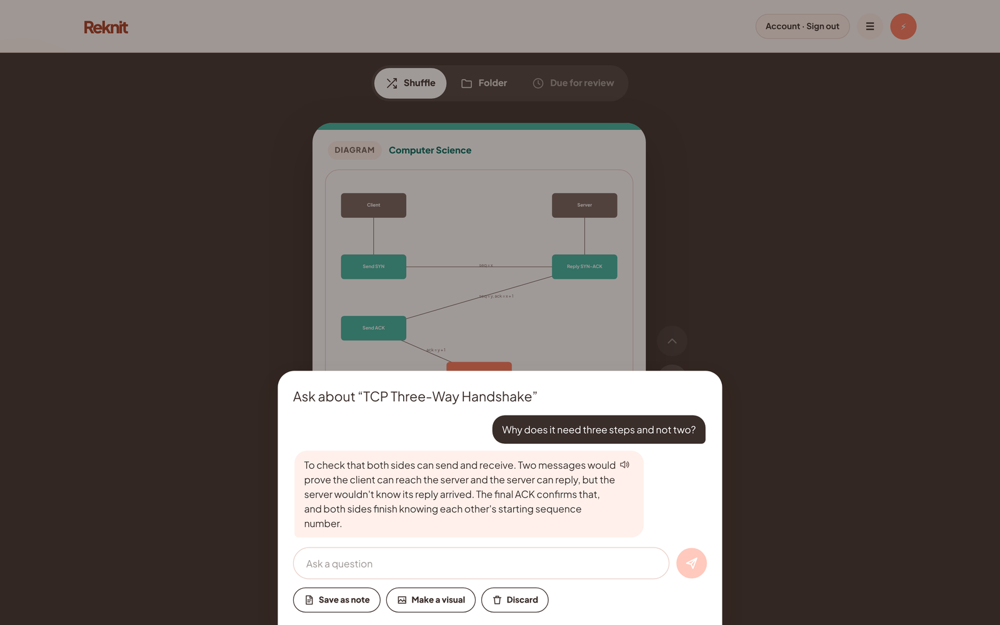
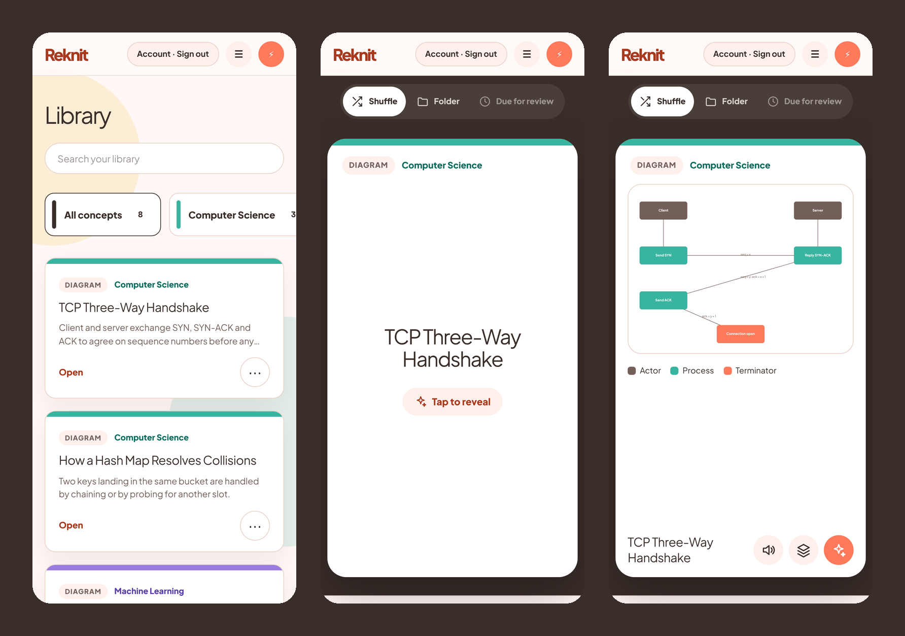
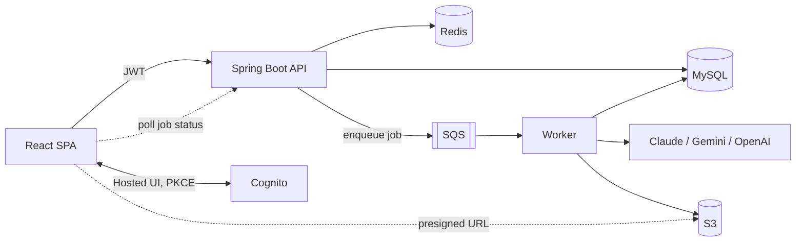

# Reknit

A visual learning workspace. You give it a topic or a page of notes, and it turns the idea into a mind map, a diagram, a short animation or an image that you can save, organise and come back to later.

I built Reknit because my own notes kept turning into a place where ideas went to be forgotten. Rereading three pages to recover one concept is slow, and most of the time I didn't bother. I wanted revisiting an old idea to take ten seconds and feel closer to looking at a picture than to studying.

## What it does

**Capture.** Type a topic, or paste your own notes. Reknit can write an explanation first if you want one, then generates a visualization. The result comes back as a draft: you can save it, regenerate it or throw it away, and nothing is stored until you save.

**Four kinds of visual.** Mind maps, diagrams, scene-by-scene animations with narration, and generated images. For animations the model decides how many scenes a topic needs and how they are paced.

**Library.** Saved concepts live in colour-coded folders with search. Regenerating a concept adds a new version instead of overwriting the old one, so you can flip back through earlier attempts.

**Connects to.** Each concept shows the other saved concepts closest to it in meaning, across folders. This is built on embeddings of your own library, so the links are between things you have actually learned.

**Spark.** A swipeable review feed of your saved concepts, shuffled or limited to one folder, with a couple of quick games mixed in. From any card you can ask a follow-up question about that concept and save the useful part of the answer as a note on it.

## Screenshots

These are taken from the app running locally against sample concepts.



### Capture

Give it a topic, with or without your own notes. Reknit can write a structured explanation first, with the idea itself, an analogy and a worked example. Then it turns that into a visual. The visual comes back as a draft, and nothing is stored until you save it.

| Explain | Visualize |
| --- | --- |
|  |  |

### Library and concept view

Saved concepts live in colour-coded folders. Opening one shows the visual, the other concepts it connects to, and any notes you saved from Spark chats. The dots under the diagram switch between versions.

| Library | Concept |
| --- | --- |
|  |  |

### Spark

Spark is the review feed. Each card shows only the title first, so you try to recall the idea before you tap to reveal it. From a revealed card you can have it read aloud, jump to related concepts, or ask a follow-up question. A useful answer can be saved as a note on the concept.

| Recall | Reveal |
| --- | --- |
|  |  |



### On a phone

The layout works on small screens, and Spark supports swipe gestures there.



## How it works



The backend is one Spring Boot codebase that runs as two processes. The API process handles requests and never calls an AI provider. Anything that needs a model becomes a job row and an SQS message, the request returns `202 Accepted`, and the browser polls `GET /api/jobs/{id}` until the job finishes. A second process, started with the `worker` profile, consumes the queue and does the slow work. A model call that hangs for a minute cannot tie up a request thread, because the request threads live in a different process.

A few decisions that shaped the rest of the code:

- **Providers sit behind interfaces.** Text, image and embedding generation each have their own interface and an ordered fallback chain set by environment variable (`TEXT_PROVIDER_ORDER=claude,gemini`). Every provider has its own retry policy and circuit breaker through Resilience4j. Adding a provider means writing one adapter class and registering one bean.
- **Model output is never trusted as-is.** The model returns JSON that is parsed into a typed payload (`MindMapPayload`, `DiagramPayload`, `AnimationPayload`, `ImagePayload`) and validated before it is stored or returned. The frontend renders that stable shape and never sees raw model output.
- **Retrieval runs on the server, in MySQL.** Embeddings are stored as JSON arrays and ranked by cosine similarity in application code. MySQL has no vector type, and at the size of one person's library this is fast enough. The lookup is a single method on `RetrievalService`, so moving to a vector store later would not touch its callers.
- **Ownership is part of the query.** Every lookup is scoped by user id (`findByIdAndUserId`). Asking for someone else's concept returns the same 404 as asking for one that does not exist.
- **Rate limits follow the user.** Bucket4j buckets are stored in Redis and keyed by user id instead of IP address, so the limit holds across instances.
- **Accounts can be deleted properly.** A deletion request starts a grace period (30 days by default) during which it can be cancelled. After that a scheduled job removes the user row and the foreign keys cascade through everything else.

## Tech stack

| Layer | What |
| --- | --- |
| Frontend | React 19, Vite, Tailwind CSS 4, React Router 7 |
| Backend | Java 21, Spring Boot 3.5, Spring Security (OAuth2 resource server), Spring Data JPA |
| Data | MySQL 8 with Flyway migrations, Redis |
| AWS | Cognito (auth), SQS (job queue), S3 (generated images) |
| AI | Anthropic Claude, Google Gemini, OpenAI |
| Resilience | Resilience4j (retry, circuit breaker), Bucket4j (rate limiting) |
| Testing | JUnit 5 for the backend, Playwright scripts for end-to-end checks |

Sign-in uses the Cognito Hosted UI with the Authorization Code + PKCE flow. I wrote that flow against the Web Crypto API instead of pulling in Amplify. Tokens are kept in `sessionStorage`, so closing the tab signs you out.

## Running it locally

You will need:

- Java 21 and Maven
- Node 22
- MySQL 8 and Redis (on Windows, Memurai works as the Redis server)
- An AWS account with a Cognito user pool and a public app client (no client secret), a standard SQS queue with a dead-letter queue, and a private S3 bucket
- A Gemini API key. Gemini alone is enough to run everything. Claude and OpenAI keys are optional.

### Backend

The backend reads all of its configuration from environment variables. There is a PowerShell template to start from:

```powershell
cd backend
copy set-env.example.ps1 set-env.ps1    # fill in your values; this file is gitignored
. .\set-env.ps1
mvn test
mvn spring-boot:run                     # API on port 8080
```

Then start the worker in a second terminal:

```powershell
. .\set-env.ps1
$env:SPRING_PROFILES_ACTIVE = "worker"
mvn spring-boot:run                     # worker on port 8081
```

On macOS or Linux, export the same variables in your shell and run `SPRING_PROFILES_ACTIVE=worker mvn spring-boot:run` for the worker. Flyway creates the schema the first time the API starts.

Both processes need to be running. Without the worker, jobs are accepted and then sit in `PENDING`.

### Frontend

```bash
cd frontend
cp .env.example .env.local    # API base URL and Cognito app client settings
npm ci
npm run dev                   # http://localhost:5173
```

Every `VITE_*` value is compiled into the browser bundle, so only public client settings belong in that file.

### Configuration

The variables you are most likely to touch. The full set, with defaults, is in [`backend/src/main/resources/application.yml`](backend/src/main/resources/application.yml).

| Variable | Purpose |
| --- | --- |
| `COGNITO_ISSUER_URI` | User pool issuer, used to validate JWTs |
| `DB_URL`, `DB_USERNAME`, `DB_PASSWORD` | MySQL connection |
| `REDIS_HOST`, `REDIS_PORT` | Rate limiter storage |
| `GENERATION_QUEUE_URL`, `GENERATION_DLQ_URL` | SQS job queue and its dead-letter queue |
| `ARTIFACTS_BUCKET` | S3 bucket for generated images |
| `GEMINI_API_KEY`, `ANTHROPIC_API_KEY`, `OPENAI_API_KEY` | Provider keys. Only the providers named in the order variables need one. |
| `TEXT_PROVIDER_ORDER`, `VISUAL_PROVIDER_ORDER`, `EMBEDDING_PROVIDER_ORDER` | Fallback order for each capability |
| `CORS_ALLOWED_ORIGINS` | Allowed frontend origins, comma separated |
| `RELATED_TOP_K`, `RELATED_MAX_DISTANCE` | How many related concepts to show, and how close they must be |

## API

Every route needs a Cognito access token as a bearer token.

| Method | Route | What it does |
| --- | --- | --- |
| `POST` | `/api/jobs/explain` | Queue an explanation for a topic |
| `POST` | `/api/jobs/visualize` | Queue a visualization. Without a `conceptId` it produces a draft; with one it adds a new version. |
| `GET` | `/api/jobs/{id}` | Job status and result |
| `POST` | `/api/concepts` | Save a draft as a concept |
| `GET` | `/api/concepts`, `/api/concepts/{id}` | List and read concepts |
| `PATCH`, `DELETE` | `/api/concepts/{id}` | Update or delete a concept |
| `GET` | `/api/concepts/{id}/versions` | Version history |
| `GET` | `/api/concepts/{id}/related` | Nearest saved concepts |
| `GET` | `/api/concepts/spark-feed` | Concepts for a Spark session |
| `POST` | `/api/concepts/{id}/ask` | Ask a question about a concept |
| `POST` | `/api/concepts/{id}/notes/from-chat` | Turn a chat answer into a note |
| `GET`, `DELETE` | `/api/concepts/{id}/notes` | List notes, delete one |
| `PUT` | `/api/concepts/{id}/folder` | Move a concept to a folder |
| `GET`, `POST`, `PATCH`, `DELETE` | `/api/folders` | Manage folders |
| `GET` | `/api/artifacts/{id}` | Presigned URL for a generated image |
| `GET`, `DELETE` | `/api/account` | Account details, request deletion |
| `POST` | `/api/account/cancel-deletion` | Cancel a pending deletion |

## Project layout

```
backend/                      Spring Boot service (API and worker)
  src/main/java/.../
    concept/                  concepts, drafts, versions, notes, Spark feed sampling
    folder/                   folders and colour assignment
    generation/               jobs, pipelines, prompts, providers, validation
    rag/                      embeddings and related-concept retrieval
    storage/                  S3 artifacts
    security/, ratelimit/     Cognito user provisioning, Redis rate limiter
    user/                     account and data deletion
    web/                      controllers, DTOs, error handling
  src/main/resources/db/migration/   Flyway migrations
  docs/design/                design notes for individual features
frontend/                     React app
  src/
    pages/                    one component per route
    features/                 capture, generate, library, spark, workspace
    api/, domain/             HTTP clients and response mappers
    auth/                     Cognito PKCE flow and session handling
    shared/                   UI primitives, hooks, narration
  scripts/                    end-to-end verification scripts
```

## Tests

```bash
cd backend && mvn test
cd frontend && npm run lint && npm run build
```

The backend has about 140 unit tests covering payload validation, provider fallback, prompt building, similarity ranking, folder rules and the save and versioning flows. None of them call a real AI provider.

The scripts in `frontend/scripts/` are end-to-end checks that drive the real UI with Playwright against a running backend. They create and delete real data, so run them with a separate test account. Each script explains its setup at the top of the file.

## CI/CD

Two GitHub Actions workflows live in `.github/workflows/`. Each runs only when its half of the repository changes.

**Backend** compiles the service and runs the tests against MySQL 8 and Redis 7 service containers, then scans the dependencies with OWASP Dependency-Check. On `main`, once the tests pass, it builds the Docker image and pushes it to GitHub Container Registry as `ghcr.io/<owner>/reknit-backend`, tagged `latest` and with the commit SHA. This needs no configuration.

**Frontend** lints, builds and runs `npm audit`. On `main` it then rebuilds with the real client settings and uploads the site to S3. The deploy job is skipped until these repository variables exist (Settings → Secrets and variables → Actions → Variables):

| Variable | Purpose |
| --- | --- |
| `AWS_DEPLOY_ROLE_ARN` | IAM role the workflow assumes through GitHub OIDC. Setting it switches the deploy on. |
| `AWS_REGION` | Region of the bucket |
| `FRONTEND_BUCKET` | S3 bucket that serves the site |
| `CLOUDFRONT_DISTRIBUTION_ID` | Optional. Invalidates `index.html` after an upload. |
| `VITE_API_BASE_URL` and the four `VITE_COGNITO_*` values | The same settings as `frontend/.env.example` |

The role needs `s3:ListBucket`, `s3:PutObject` and `s3:DeleteObject` on the bucket, plus `cloudfront:CreateInvalidation` if you use CloudFront. No AWS keys are stored in GitHub.

## Status

Reknit is a personal project and still in development. Capture, the library, folders, versioning, related concepts and Spark all work end to end. Some things are not finished:

- The two games in Spark are placeholders.
- A "due for review" mode based on review history is planned but not built.
- There is no infrastructure-as-code yet. The AWS resources are created by hand, and the backend image is published but not yet rolled out automatically.
- Narration uses the browser's built-in speech synthesis.

## Author

Built by Surabhi Sonkar ([@Surabhisonkar](https://github.com/Surabhisonkar)).
